# Industrial Plant Design: Agricultural Machinery Factory

**Course:** Industrial Plants and Safety, Politecnico di Torino (Prof. A. Chiaraviglio), A.Y. 2024/25. 

**Grade:** 30L/30

**Group B1:** 14 students in two teams. Team A designed the rotary-tiller areas; **Team B** (Fatima Zouhour, Fatima Srour, Mehdi Farhat, Mahdi Ghrayeb, Kassem Damergi, Yagiz Ozer, Muhammad Salomov) designed the **flail-mower** areas.

**Tools:** Excel (all calculations), AutoCAD (layouts)

This repository documents the **flail-mower** part (Team B) and the shared plant-level results.

Preliminary design of a greenfield production and logistics plant in northern Italy for two agricultural machines: **rotary tillers** and **flail mowers**, each in two widths (L = 1500 and 1750 mm). It covers everything from the bill of materials and machine counts to warehouses, docks, forklifts, a NIOSH manual-handling study and the full plant layout.

  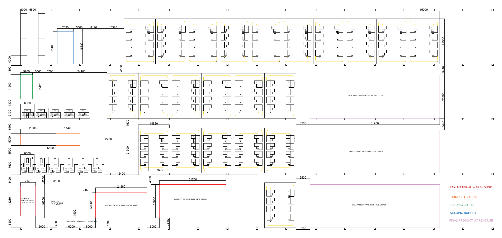

---

## What's in here

| Folder | Contents |
|---|---|
| [`workbook/`](workbook/) | The calculation workbook (14 sheets). `..._ORIGINAL.xlsx` is the version as submitted; `..._CORRECTED.xlsx` has 6 formula fixes, listed in [CORRECTIONS.md](CORRECTIONS.md). |
| [`report/`](report/) | The final group report (44 pages) as submitted, with matriculation numbers removed. |
| [`drawings/`](drawings/) | AutoCAD plant layout (A2, PDF). |
| [`images/`](images/) | The figures used below; `images/brief/` holds the figures taken from the course requirements. |

> The results below are taken from the **corrected** workbook. Where they differ from the submitted report, [CORRECTIONS.md](CORRECTIONS.md) explains why.

---

## 1. Required production

Demand is set by the brief: annual base production × a group factor (from the team members' initials: Cm = 13, Nm = 12, so a factor of 1.5 × 25/30 = 1.25). The plant runs 220 days/year, 22 days/month, and 2 shifts (15 h/day), giving **330 h/month**.

| Flail mower | Pieces / month |
|---|---|
| L = 1500 (60 %) | **9,389** |
| L = 1750 (40 %) | **6,260** |
| Total | **15,649** (≈ 711 / day) |

## 2. Bill of materials and material flow

The plant makes two product families, each in two widths:

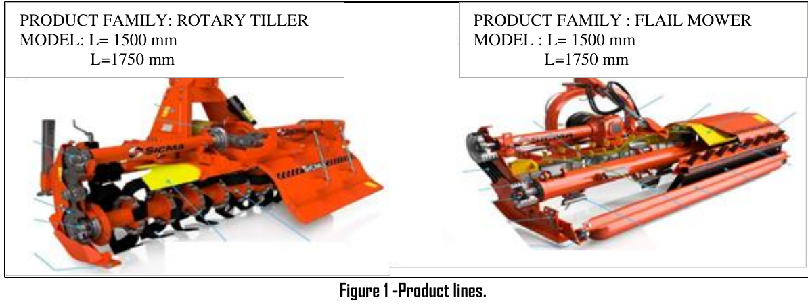

Each mower is a welded frame (guard, reinforcement brackets, hitch plates, rake) plus purchased drive shaft, gears and hammer shaft. Parts are made by **stamping → bending → welding → assembly**. The simplified flail mower used in the project:

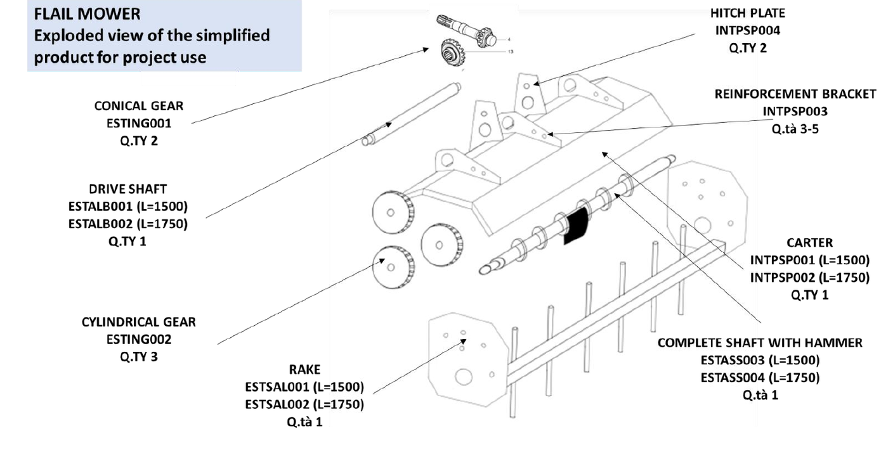
 **stamping → bending → welding → assembly**.

| L = 1500 | L = 1750 |
|---|---|
| 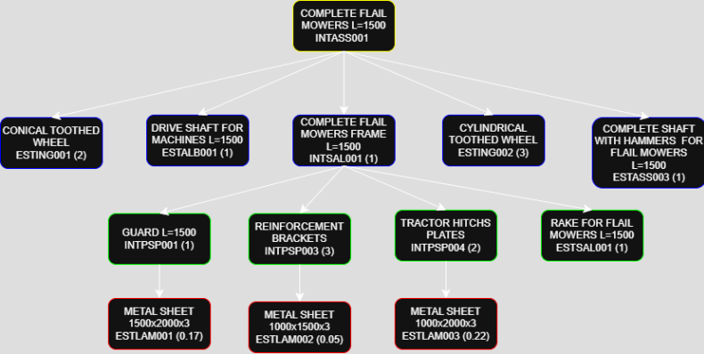 | 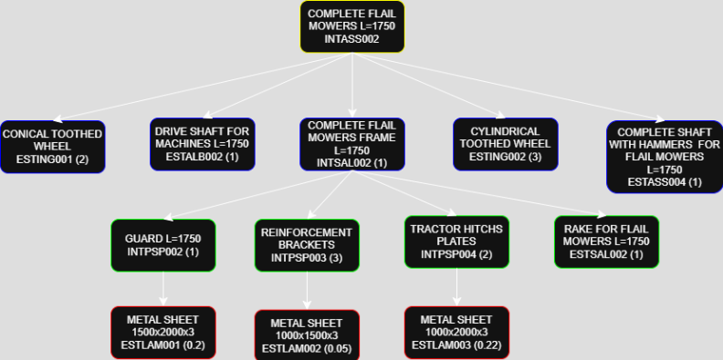 |

Because each department scraps a few parts, the quantity each upstream step must *start* is grossed up by its quality rate. For the L = 1500 guard: **9,389** mowers → **9,679** frames welded (Q = 97 %) → **9,877** guards bent (98 %) → **9,977** blanks stamped (99 %).

Monthly flows in load units (LU) between departments:

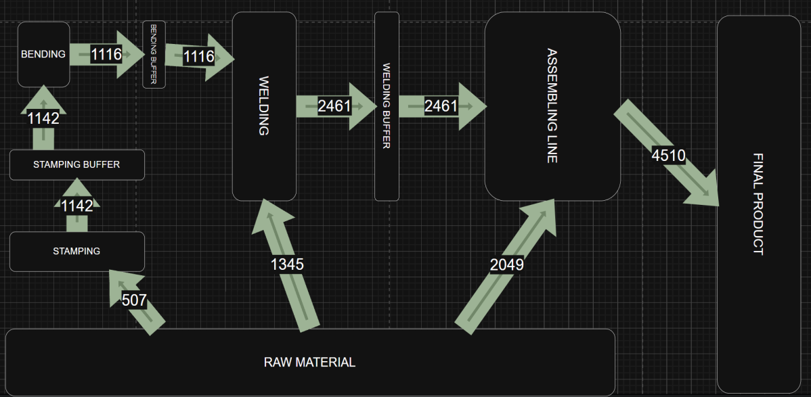

## 3. Machines and layout type

The machine count per department is total work time ÷ net available time per machine. Net available time = 330 h × availability − set-ups, then × performance.

| Department | Theoretical | **Installed** | OEE |
|---|---|---|---|
| Stamping (punching machines) | 2.9 | **3** | 0.89 |
| Bending (press brakes) | 2.9 | **3** | 0.88 |
| Welding boxes | 7.4 | **8** | 0.80 |
| Final assembly lines | 1.9 | **2** | |

Welding (8 min/frame) is the bottleneck. So stamping, bending and welding are laid out as **departments** (machines can be added flexibly), and only final assembly runs as **lines**.

The machines and their footprints (mm), as given in the brief, were used to size the departments:

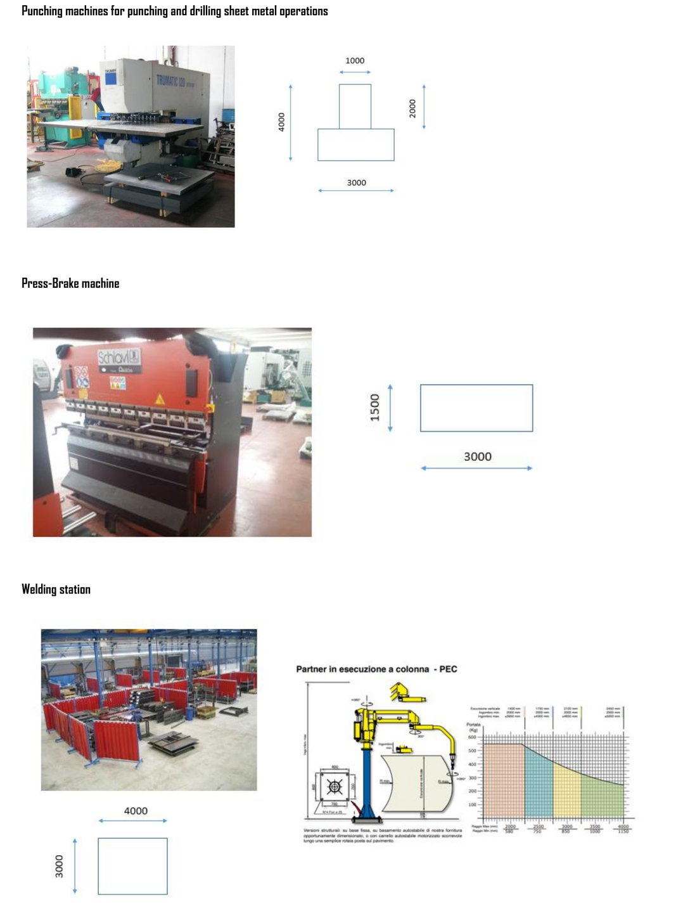

## 4. Assembly line balancing

Final assembly is 13 tasks (A–O) totalling 6.3 min, with this precedence order:

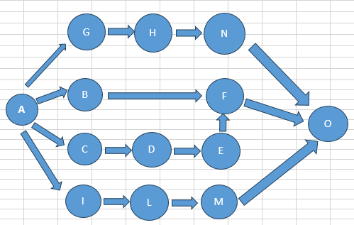

The tasks were assigned to stations with the **Ranked Positional Weight (RPW)** method against the 2.0 min cycle time. Two valid solutions were produced:

- **Straight line (workbook):** A-I-C-D | G-L-H | E-B-F-M | N-O. Station 4 is only 42 % loaded.
- **U-shaped line (report):** stations can take tasks from both the start and the end of the sequence. Load is much more even.

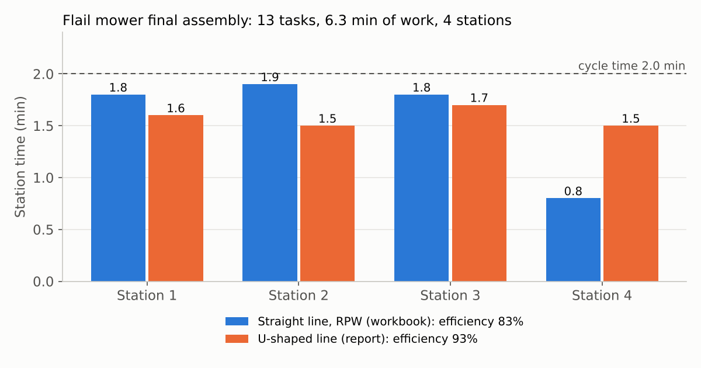

| U-line station assignment | Assembly station with AGV |
|---|---|
| 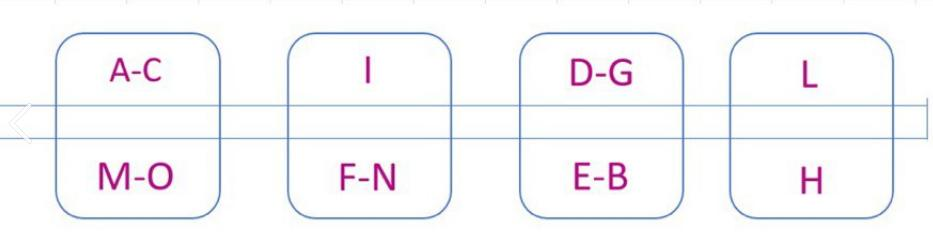 | 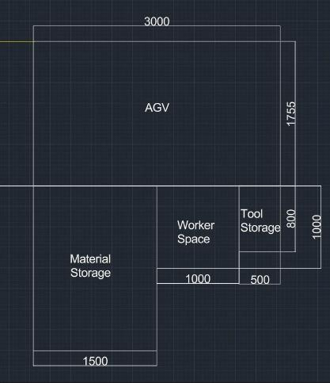 |

Result: **2 lines × 4 stations** for the flail mower.

## 5. Workstation design (1 : 25)

Team B designed the stamping workstation: machine, material and WIP storage, tool storage and operator space.

| Stamping workstation | Bending workstation |
|---|---|
| 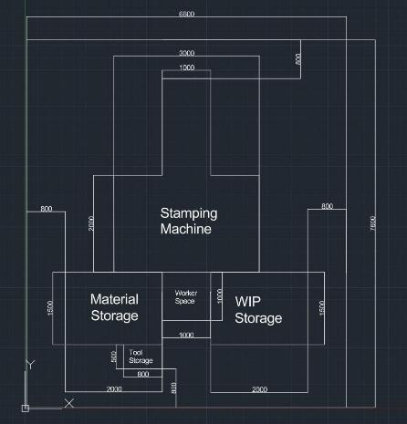 | 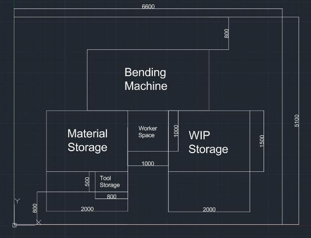 |

## 6. Warehouses

| Area | Storage system |
|---|---|
| Raw materials | Selective pallet racking (direct access to every pallet) |
| Stamping / bending / welding buffers | Drive-through racking |
| Finished products | Live (flow) storage |

Raw-material stock is sized from each family's **reorder cycle + safety stock** (brief, Table 10b). The inventory turnover index is monthly consumption ÷ average stock:

| Purchased item (flail mower) | Reorder / safety (days) | Max stock (LU) | Turnover / month |
|---|---|---|---|
| Metal sheet 1500×2000×3 | 10 / 3 | 79 | 2.75 |
| Metal sheet 1000×1500×3 | 10 / 3 | 75 | 2.75 |
| Metal sheet 1000×2000×3 | 10 / 3 | 197 | 2.75 |
| Conical / cylindrical gears | 3 / 1 | 29 / 44 | 8.8 |
| Drive shafts L1500 / L1750 | 10 / 3 | 115 / 74 | 2.75 |
| Shafts with hammers L1500 / L1750 | 5 / 1 | 220 / 143 | 6.3 |
| Rakes L1500 / L1750 | 10 / 3 | 477 / 318 | 2.75 |

Finished-product and semi-finished buffers hold one production batch + 20 % safety stock, e.g. 600 LU for complete L = 1500 mowers.

## 7. Receiving, shipping and internal transport

Deliveries were spread over a 4-week timetable to avoid oversizing the docks, which were sized for the worst day (whole plant, FEU trucks, 45 min per truck, 15 h/day):

| | Worst-case LU / day | Trucks / day | Trucks / hour | **Docks** | Buffer area |
|---|---|---|---|---|---|
| Receiving | 918 | 27 | 3 | **3** | 93 m² |
| Shipping | 1,730 | 82 | 6 | **5** | 261 m² |

**Forklifts** were sized from monthly LU moves on each route, worst-case distances measured on the layout, travel and lift speeds, and a 45 s fixed time. The flail-mower routes need 3.5 trucks, so **4**, plus 2 at the docks. With the rotary-tiller area, the plant needs **9 forklifts** in total.

## 8. Safety: NIOSH lifting study

**Task:** at the bending and stamping station, the operator lowers parts from a 100 cm work height into a load unit at 50 cm, at 40 cm horizontal distance, with poor coupling. The sequence is three 2-hour tasks: L = 1500 guards (11.9 kg), L = 1750 guards (14.0 kg) and hitch brackets (10.3 kg).

Recommended weight limit: **RWL = 25 kg × HM × VM × DM × AM × CM × FM**. The lifting index is **LI = load ÷ RWL**, and LI > 1 means increased risk.

| Part | Load | LI (with frequency) | FILI (frequency-independent) |
|---|---|---|---|
| Guard L = 1500 | 11.9 kg | 1.34 | 1.01 |
| **Guard L = 1750** | **14.0 kg** | **1.58** | **1.19** |
| Hitch bracket | 10.3 kg | 1.34 | 0.87 |

**The whole task sequence** has a Sequential Lifting Index of **SLI = 1.37**, so it is above the limit.

**What this means:** the L = 1750 guard is over the limit even with *no* frequency penalty (FILI > 1). Sharing the work with a second operator reduces lifting frequency, but it cannot bring this task below 1 on its own. The geometry has to change:
- Bringing the load to **≤ 35 cm** horizontal distance with fair handholds brings FILI below 1.
- **≤ 28 cm** with good handholds brings the full LI below 1.
- Alternatively, a vacuum lifting aid removes the manual lift.

## 9. Staffing and site

**Staffing (whole plant, 2 shifts): 156 people.**

| Area | Per shift |
|---|---|
| Stamping | 6 |
| Bending | 5 |
| Welding | 13 |
| Assembly (2 + 2 lines × 4 stations) | 16 |
| Forklift drivers | 9 |
| Hand-truck operators | 8 |
| Supervisors | 8 |
| Indirect staff (20 %) | 13 |

**Site:** Melegnano (MI), about 4 minutes by road from the main supplier, with separate roads for incoming and outgoing trucks.

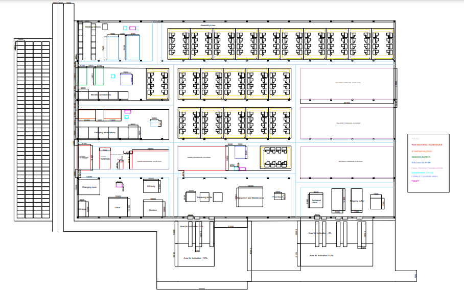

---
Product photos, the exploded view and the machine sheet (in `images/brief/`) are from the course project requirements (Industrial Plants and Safety, Politecnico di Torino, A.Y. 2024/25), reproduced for reference.

## Opening the workbook

The corrected workbook recalculates automatically when opened in Excel. In viewers that don't recalculate, the six edited cells may show as blank. The original file is kept unchanged for comparison.
